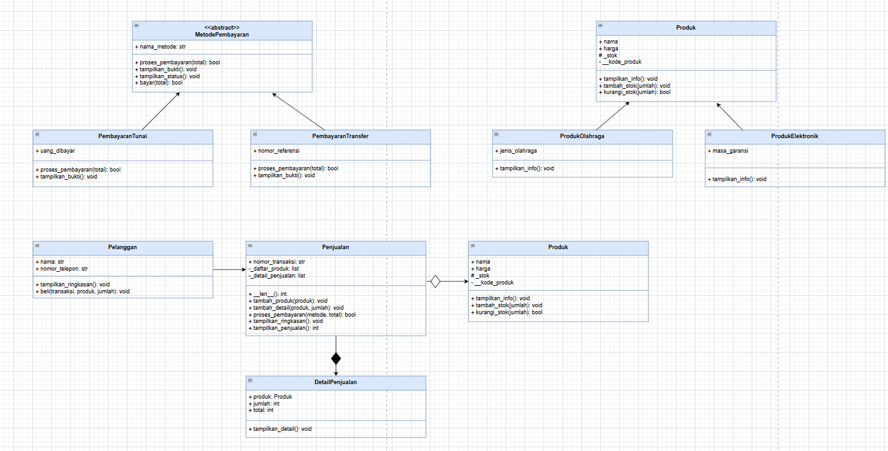
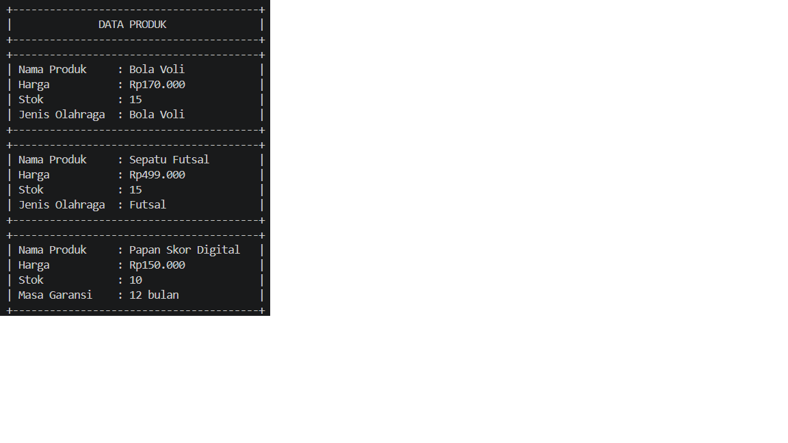
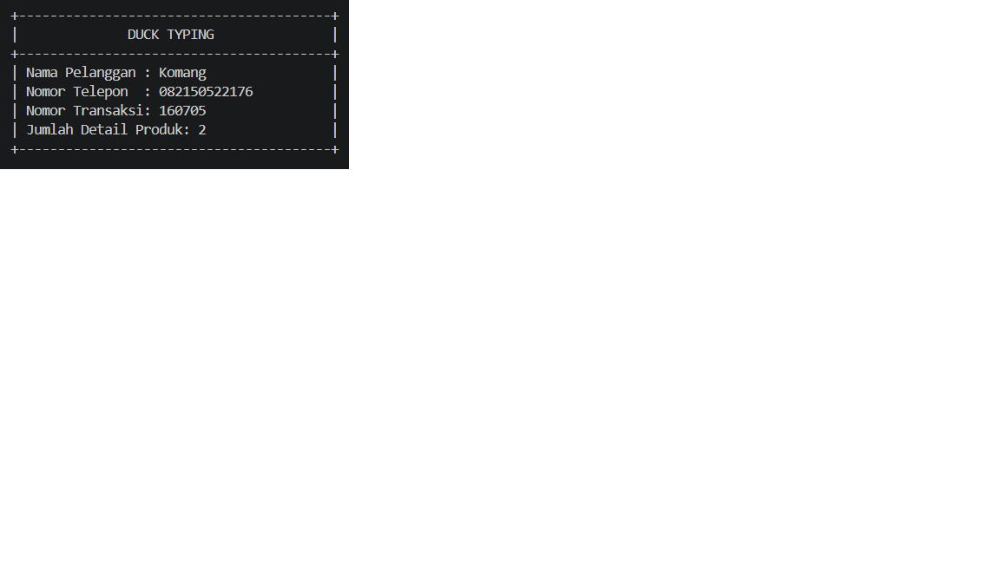
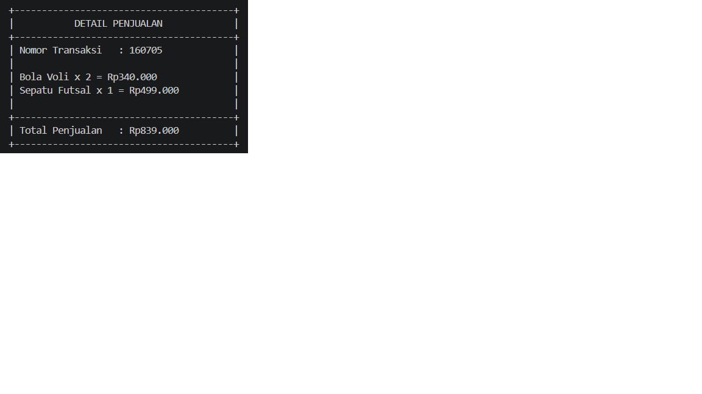
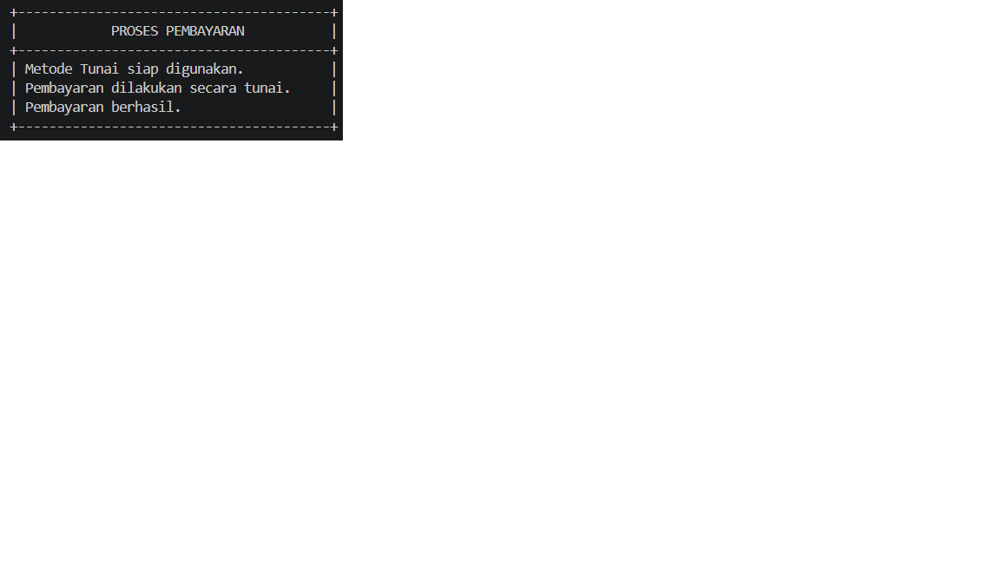
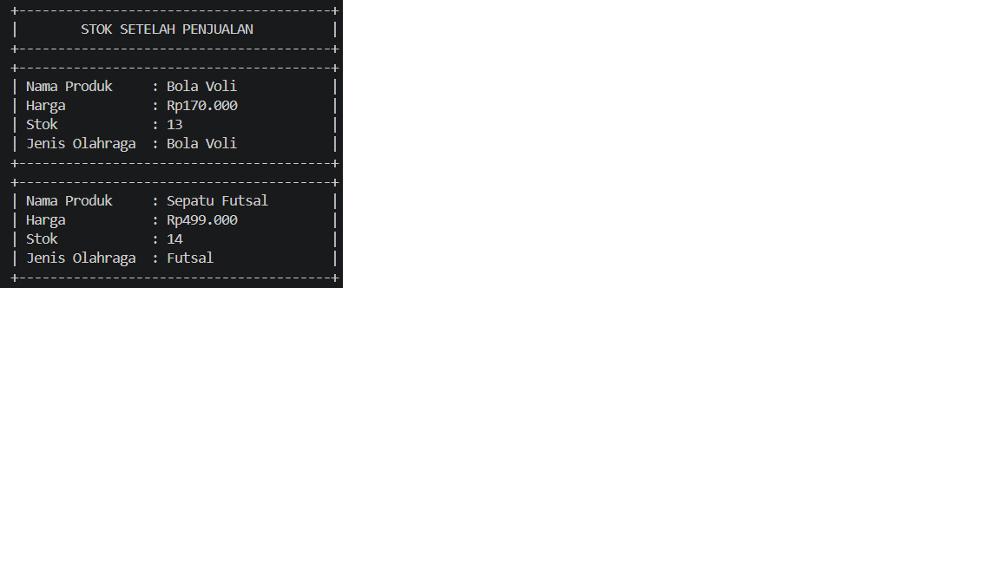
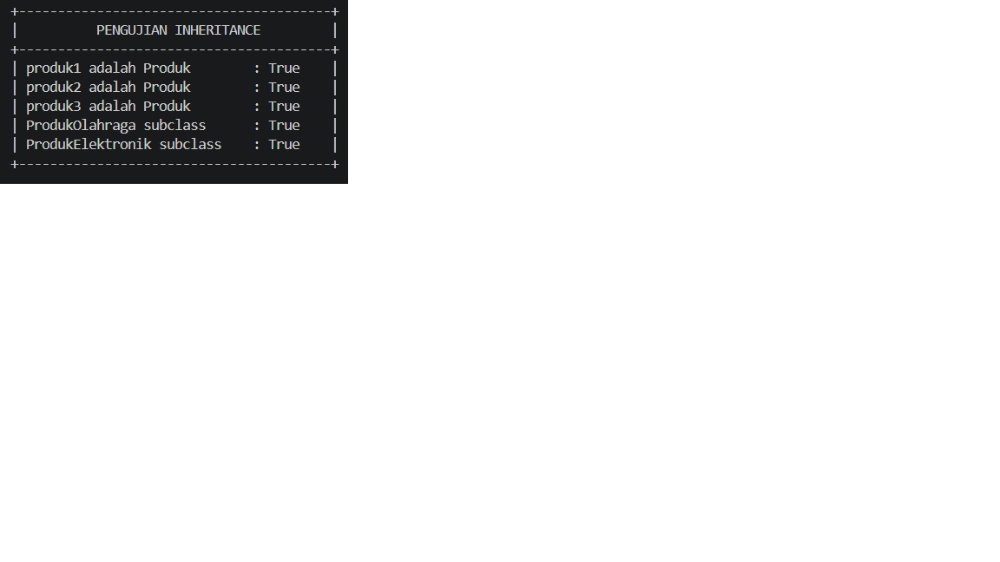
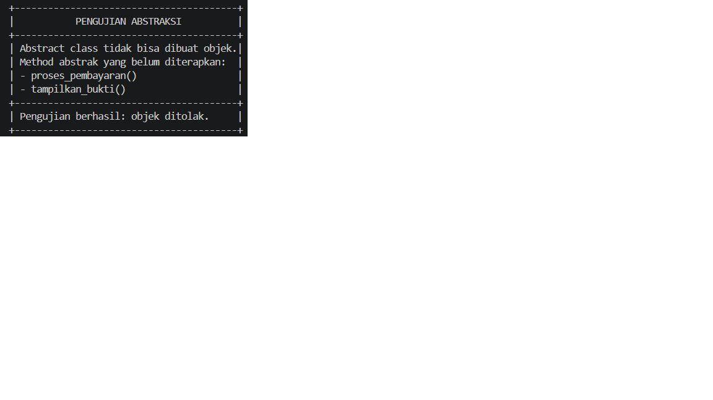

# Laporan Posttest 3 - Pemrograman Berorientasi Objek (PBO)

## Identitas 
* **Nama**: Ni Komang Kariani
* **NIM**: 2509106003
* **Mata Kuliah**: Pemrograman Berorientasi Objek
* **Program Studi**: Informatika
* **Universitas**: Universitas Mulawarman

---

## 1. Judul dan Deskripsi Singkat Program
* **Judul Program**: Sistem Manajemen Penjualan Toko Perlengkapan Olahraga Berbasis OOP.
* **Deskripsi Singkat**: 
  Program ini saya kembangkan sebagai bentuk kelanjutan dari sistem manajemen toko perlengkapan olahraga pada posttest sebelumnya. Pada **Posttest 3** ini, fokus utama program adalah menerapkan konsep *Object-Oriented Programming* (OOP) tingkat lanjut yang mencakup **Abstraksi (*Abstract Base Class*)**, **Polimorfisme** (melalui *method overriding*, *duck typing*, dan *operator overloading*), serta kelengkapan relasi UML (**Asosiasi, Agregasi, dan Komposisi**). 
  
  Melalui program ini, saya mengelola berbagai entitas seperti data produk (olahraga dan elektronik) dengan enkapsulasi atribut, data pelanggan, pencatatan transaksi penjualan, rincian detail item belanja, hingga sistem pemrosesan pembayaran yang modular dan terstruktur tanpa melanggar prinsip desain objek.

---

## 2. Class Diagram & Penjelasan Relasi UML
Berikut adalah rancangan struktur kelas (*Class Diagram*) yang telah saya buat dan diekspor ke dalam program:

### Penjelasan Detail Relasi UML:
1. **Asosiasi (`Pelanggan` $\rightarrow$ `Penjualan`)**:
   * **Penjelasan**: Hubungan ini menghubungkan kelas `Pelanggan` dan kelas `Penjualan` saat pelanggan melakukan aksi pembelian melalui metode `beli()`.
   * **Alasan Pemilihan**: Saya memilih relasi asosiasi karena kedua kelas ini dapat berdiri sendiri sebagai objek mandiri, di mana objek pelanggan berinteraksi secara fungsional untuk memicu proses transaksi penjualan.
2. **Agregasi (`Penjualan` $\rightarrow$ `Produk`)** *(Dilambangkan dengan simbol belah ketupat kosong / `◇` di sisi Penjualan)*:
   * **Penjelasan**: Menghubungkan kelas transaksi `Penjualan` dengan objek-objek `Produk` yang dibeli oleh pelanggan.
   * **Alasan Pemilihan**: Saya menggunakan agregasi karena objek `Produk` didaftarkan ke dalam transaksi, namun objek produk tersebut **dapat berdiri sendiri secara mandiri** (*standalone*). Jika transaksi penjualan dibatalkan atau dihapus, objek produk tidak ikut musnah dari sistem.
3. **Komposisi (`Penjualan` $\rightarrow$ `DetailPenjualan`)** *(Dilambangkan dengan simbol belah ketupat hitam / `◆` di sisi Penjualan)*:
   * **Penjelasan**: Menghubungkan kelas transaksi `Penjualan` dengan rincian kelas `DetailPenjualan`.
   * **Alasan Pemilihan**: Saya menggunakan komposisi karena objek `DetailPenjualan` dibentuk, hidup, dan dikelola sepenuhnya di dalam siklus hidup objek transaksi `Penjualan`. Objek detail ini tidak memiliki makna atau eksistensi independen di luar transaksi tersebut (jika transaksi dihapus, rincian detail penjualannya otomatis ikut terhapus).

---

## 3. Penerapan Abstraksi dan Polimorfisme

### A. Abstraksi (*Abstract Base Class* / ABC)
Dalam program ini, saya menerapkan konsep Abstraksi untuk menetapkan standarisasi kerangka kerja pembayaran:
* **Abstract Class**: Saya membuat kelas `MetodePembayaran` yang mewarisi modul `ABC` (*Abstract Base Class*).
* **Abstract Methods (`@abstractmethod`)**: Terdapat 2 metode abstrak wajib di dalam kelas induk ini yang sengaja tidak memiliki isi implementasi, yaitu:
  1. `proses_pembayaran(total)`
  2. `tampilkan_bukti()`
* **Implementasi pada Subclass**: Kedua metode abstrak di atas wajib di-*override* dan diimplementasikan secara spesifik oleh seluruh kelas turunannya (*subclass*), yaitu kelas `PembayaranTunai` dan kelas `PembayaranTransfer`.
* **Method Konkret**: Selain metode abstrak, kelas induk `MetodePembayaran` juga memiliki metode konkrit yang dapat langsung dipakai bersama tanpa harus ditulis ulang, yaitu:
  * `tampilkan_status()`: Digunakan untuk menampilkan status kesiapan metode pembayaran.
  * `bayar(total)`: Mengatur alur logika transaksi pembayaran secara menyeluruh.
* **Bukti Abstraksi (Uji Coba *Try-Except TypeError*)**:
  Di bagian akhir program, saya menyertakan blok pengujian menggunakan `try-except TypeError` untuk membuktikan secara nyata bahwa kelas abstrak `MetodePembayaran` **tidak dapat diinstansiasi secara langsung** menjadi objek. Jika dipaksa, Python akan memunculkan galat `TypeError`.

### B. Polimorfisme
Program saya mengimplementasikan tiga bentuk polimorfisme secara lengkap:
1. **Polimorfisme via Pewarisan (*Method Overriding*)**:
   * Metode abstrak `proses_pembayaran()` dan `tampilkan_bukti()` di-*override* dengan perilaku serta logika yang berbeda di dalam kelas turunan `PembayaranTunai` (memeriksa kecukupan uang tunai pembeli) dan kelas `PembayaranTransfer` (memeriksa validitas total dan menampilkan nomor referensi transfer).
2. **Duck Typing**:
   * Saya menerapkannya melalui fungsi global bebas bernama `tampilkan_ringkasan(objek)`. Fungsi ini menerima argumen objek apa saja secara dinamis tanpa melakukan pengecekan tipe kelas (`isinstance`). Selama objek tersebut memiliki metode bernama `tampilkan_ringkasan()`, fungsi akan mengeksekusinya dengan sukses (diterapkan pada kelas `Pelanggan` dan kelas `Penjualan`).
3. **Operator Overloading**:
   * Saya menggunakan *magic method* `__len__` pada kelas `Penjualan`. Hal ini memungkinkan fungsi bawaan Python `len(objek_penjualan)` dipanggil secara langsung untuk menghitung berapa banyak item detail produk yang tersimpan di dalam transaksi tersebut.

### C. Penghindaran Anti-Pattern
* Dalam menyusun logika program, saya menghindari penggunaan rantai pengkondisian `if / elif` yang mengecek tipe kelas (`type()`) atau string jenis produk secara manual. Setiap objek pada program saya diatur untuk menentukan perilakunya sendiri secara mandiri melalui pemanggilan metode polimorfik.

---

## 4. Nilai Plus: Penerapan Prinsip SOLID (*Dependency Inversion Principle*)
Sebagai nilai tambah, saya menerapkan prinsip **Dependency Inversion Principle (DIP)** melalui teknik **Dependency Injection** pada struktur kode saya:
* **Bagian Kode**: Terdapat pada metode `proses_pembayaran(self, metode: MetodePembayaran, total)` di dalam kelas `Penjualan`.
* **Penjelasan**: Alih-alih membuat kelas `Penjualan` bergantung langsung pada kelas konkret tingkat rendah seperti `PembayaranTunai` atau `PembayaranTransfer`, saya merancangnya agar bergantung pada abstraksi induknya (`MetodePembayaran`). Hal ini membuat sistem menjadi sangat fleksibel, di mana objek metode pembayaran apa pun dapat disuntikkan (*injected*) ke dalam transaksi secara modular tanpa harus mengubah kode inti di dalam kelas `Penjualan`.

---

## 5. Screenshot Output Program

